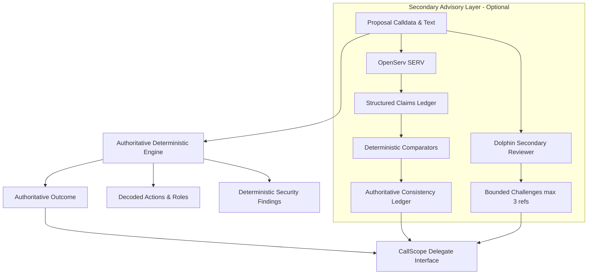

# Sponsor Integration Notes: OpenServ SERV & Dolphin

CallScope pairs an authoritative deterministic on-chain governance engine with bounded advisory intelligence from two hackathon sponsor providers: **OpenServ SERV** and **Dolphin**.

This document outlines the architectural boundary, provider capabilities, native features versus completion fallbacks, and security invariants.

---

## 1. Core Architectural Boundary

> [!IMPORTANT]
> **Deterministic Engine Stays Authoritative.**
> LLM output may propose claims or advisory challenges. It must **never** set an assessment outcome, finding severity, or consistency verdict. Every verdict is computed strictly from verified EVM bytecode, calldata decodings, and deterministic comparison rules.

---

## 2. OpenServ SERV Integration

OpenServ SERV is used natively as a **guarded, tool-grounded investigator** for governance proposal scrutiny:

### A. OpenServ Agent Framework Parameters
CallScope explicitly configures OpenServ's native agent runtime parameters:
- `serv_prompt_guard: true`: Hardware/runtime-level prompt injection boundary defense. Analyzes untrusted proposal descriptions and calldata strings before model reasoning. Detects and blocks jailbreaks, command overrides, and evasion attempts, mapping directly to `status: 'guard_blocked'`.
- `serv_shadow_agent: true`: OpenServ's dual-agent verification mechanism. A secondary shadow agent runs alongside the primary investigator to validate that claims, citations, and quotes match ground truth verbatim before delivery.
- `reasoning_effort: low`: Fast-turn reasoning mode optimized for real-time governance delegate workflows, bounded within Vercel's serverless budget (under 15s per attempt).
- **Strict JSON Schema Configuration**: Employs structured JSON schema enforcement (`response_format: { type: 'json_object' }` and typed output schemas) ensuring all emitted reviews adhere strictly to the TypeScript contract without conversational preamble.

### B. Tool-Grounded Investigator Architecture (`server/providers/serv.ts`)
Rather than relying on ungrounded text generation, SERV operates as a tool-grounded investigator backed by five deterministic engine tools:
1. `get_action(index: number)`: Retrieves decoded action details (target contract, value, decoded function signature, arguments, raw calldata).
2. `get_role_capabilities(roleHash: string, target: string)`: Inspects verified contract source and returns capability mappings and execution access gates.
3. `get_recipient_profile(address: string)`: Inspects target/recipient addresses for EOA vs contract bytecode, deployment timestamp, and explorer verification status.
4. `get_token_metadata(token: string)`: Retrieves token symbol, verified decimal precision, and canonical registry status.
5. `get_description_section(sectionIndex: number)`: Fetches individual markdown sections of the proposal description to isolate specific commitments.

#### Mandatory Tool-Call Evidence Gate:
Every tool execution generates a deterministic evidence record with an ID (e.g. `tool-call-1`, `tool-call-2`). Every review item emitted by SERV **must** cite a valid tool-call evidence ID (`item.evidenceId` or citation in `item.evidence`). The deterministic engine enforces this gate: **any uncited review item is strictly dropped before presentation**.

### C. Structured Claims Extraction (`server/analysis/claims-ledger.ts`)
Instead of using unconstrained text completions, CallScope requests structured JSON output via `response_format: { type: 'json_object' }`:
- **Native Prompting Schema**: Emits an array of atomic claims: `{ id, quote, category, params }`.
- **Verbatim Substring Guard**: Every extracted claim must feature a `quote` that is an exact, case-sensitive substring of the proposal markdown. Any hallucinated or paraphrased quotes are immediately dropped before evaluation.
- **Deterministic Category Verification**:
  - `recipient`: Address equality check against action targets or parameter arguments.
  - `amount`: Multi-decimal match (raw BigInt, 6 decimals for USDC/USDT, 18 decimals for WETH/UNI, and formatted human strings).
  - `role`: Role constant matching against standard OpenZeppelin role hashes (`PROPOSER_ROLE`, `DEFAULT_ADMIN_ROLE`).
  - `capability`: Cross-examination of power assertions (e.g. "cannot propose", "only power: cancel") against granted role capabilities.
  - `ownership`, `upgrade`, `duration`: Evaluated against action signatures or categorized as `not_checkable` for off-chain promises.

### D. Description-Calldata Advisory Review (`server/providers/serv.ts`)
- Focuses on unstated consequences, discrepancies between narrative intent and bytecode execution, and governance risks.
- Outputs typed `ReviewItem` instances (`supported`, `unsupported_claim`, `risk`, `contradiction`, `note`) with associated issue text and collapsed evidence lines.

---

## 3. Dolphin Integration (`server/providers/dolphin.ts`)

Dolphin operates as an **adversarial scenario generator and second-opinion auditor**:
- **Inference Model & Infrastructure**: Hosted on Dolphin Lighthouse infrastructure (`https://lighthouse.dphn.ai/run/text-v/v1/chat/completions`) powered by `deepseek-ai/DeepSeek-V4.1-Flash`. Attributed explicitly in the UI and documentation.
- **Adversarial Attack Scenario Generation**: Generates up to 3 concrete multi-step attack scenarios targeting proposal execution hazards:
  - Schema: `{ id, title, preconditions[], steps[{ actionRef, findingRef, description }], impact, severityHint }`.
- **Deterministic Engine Rebuttal Loop (`evaluateScenarioRebuttal`)**:
  Every proposed scenario is cross-examined by the deterministic engine against verified bytecode, calldata arguments, role capabilities, recipient profiles, and findings:
  1. `refuted_by_data`: Scenario assumptions are directly disproved by deterministic facts (e.g. action transfers 0 ETH, or contract source proves role is strictly limited to `cancel()`, or referenced action/finding does not exist).
  2. `not_refuted`: Scenario mechanism is substantiated by on-chain findings or verified role capabilities (e.g. role grants `schedule()` on TimelockController, or high-severity finding confirms hazard).
  3. `needs_human`: Scenario relies on off-chain assumptions (multisig signer compromise, off-chain social engineering) requiring delegate discretion.
- **Reference Integrity Gate**: Secondary observations outside scenarios are capped at 3 items; each must reference a valid `actionRef` or `findingRef`.
- **Tri-Reviewer Agreement Strip**: The UI dynamically compares three independent pillars:
  1. Deterministic Engine: baseline assessment outcome (`review_recommended` vs `no_significant_issue_detected`).
  2. OpenServ SERV: extended claims ledger check (`inconsistent`, `partially_verified`, or `consistent`).
  3. Dolphin: adversarial attack scenarios (`not_refuted`, `needs_human`, or `refuted_by_data`).

---

## 4. Native Features vs Fallback Completions

| Feature | OpenServ SERV Native Mode | Heuristic / Fallback Mode |
| :--- | :--- | :--- |
| **Claim Extraction** | Structured JSON schema via API endpoint (`SERV_API_KEY`) | Regex & clause pattern matching (`extractFallbackClaims`) with exact substring quotes |
| **Consistency Mode** | Full Claims Ledger (`mode: 'claims_ledger'`) | Truthful fallback banner: `"Keyword check only. Claims were not individually verified."` |
| **Provider Reviews** | Asynchronous Phase 2 review loading via `/api/review` | Graceful `status: 'not_configured'` card; zero impact on deterministic analysis |
| **Prompt Injection Defense** | Input sanitized and wrapped in rigid XML delimiter boundaries | Evaluated purely in local code without LLM exposure |
| **Failure Isolation** | Isolated 10s timeout with 1 automatic retry | Instant fallback to deterministic conclusions |

---

## 5. Security & Isolation Guarantees

1. **Zero Client-Side Keys**: `SERV_API_KEY` and `DOLPHIN_API_KEY` exist solely in server environment variables. They never enter the client bundle (enforced by automated secret isolation audits).
2. **Server-Side Cache Recomputation**: The `/api/review` endpoint loads context from cache keys `(network, governor, proposalId)`. It never accepts calldata, descriptions, or prompts from client POST payloads, preventing client-controlled prompt injection.
3. **Independent Failure Isolation**: OpenServ and Dolphin run in parallel with independent timeouts. An error or timeout in one sponsor never slows or fails the other.

