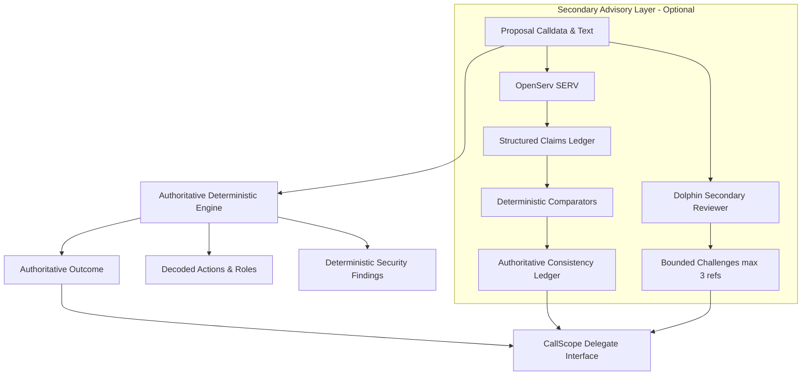

# Sponsor Integration Notes: OpenServ SERV & Dolphin

CallScope pairs an authoritative deterministic on-chain governance engine with bounded advisory intelligence from two hackathon sponsor providers: **OpenServ SERV** and **Dolphin**.

This document outlines the architectural boundary, provider capabilities, native features versus completion fallbacks, and security invariants.

---

## 1. Core Architectural Boundary

> [!IMPORTANT]
> **Deterministic Engine Stays Authoritative.**
> LLM output may propose claims or advisory challenges. It must **never** set an assessment outcome, finding severity, or consistency verdict. Every verdict is computed strictly from verified EVM bytecode, calldata decodings, and deterministic comparison rules.

---

## 2. OpenServ SERV Integration

OpenServ SERV is used for two critical governance analysis phases:

### A. Structured Claims Extraction (`server/analysis/claims-ledger.ts`)
Instead of using unconstrained text completions, CallScope requests structured JSON output via `response_format: { type: 'json_object' }`:
- **Native Prompting Schema**: Emits an array of atomic claims: `{ id, quote, category, params }`.
- **Verbatim Substring Guard**: Every extracted claim must feature a `quote` that is an exact, case-sensitive substring of the proposal markdown. Any hallucinated or paraphrased quotes are immediately dropped before evaluation.
- **Deterministic Category Verification**:
  - `recipient`: Address equality check against action targets or parameter arguments.
  - `amount`: Multi-decimal match (raw BigInt, 6 decimals for USDC/USDT, 18 decimals for WETH/UNI, and formatted human strings).
  - `role`: Role constant matching against standard OpenZeppelin role hashes (`PROPOSER_ROLE`, `DEFAULT_ADMIN_ROLE`).
  - `capability`: Cross-examination of power assertions (e.g. "cannot propose", "only power: cancel") against granted role capabilities.
  - `ownership`, `upgrade`, `duration`: Evaluated against action signatures or categorized as `not_checkable` for off-chain promises.

### B. Description-Calldata Advisory Review (`server/providers/serv.ts`)
- Focuses on unstated consequences, discrepancies between narrative intent and bytecode execution, and governance risks.
- Outputs typed `ReviewItem` instances (`supported`, `unsupported_claim`, `risk`, `contradiction`, `note`) with associated issue text and collapsed evidence lines.

---

## 3. Dolphin Integration (`server/providers/dolphin.ts`)

Dolphin (`deepseek-ai/DeepSeek-V4.1-Flash`) serves as an adversarial second opinion:
- **Scope**: Challenges unverified assumptions, inspects role grants, and identifies execution anomalies.
- **Reference Integrity Gate**: Dolphin is strictly capped at a maximum of 3 items. Every item **must** carry a valid `actionRef` (index into `actions`) or `findingRef` (ID of an existing deterministic finding). Items with invalid or missing references are automatically dropped by the server.
- **Secondary Review**: Dolphin reviews cannot modify findings or downgrade severity. If Dolphin flags a risk on an action that the engine considered routine, the discrepancy is surfaced in the Reviewer Agreement Strip for delegate scrutiny.

---

## 4. Native Features vs Fallback Completions

| Feature | OpenServ SERV Native Mode | Heuristic / Fallback Mode |
| :--- | :--- | :--- |
| **Claim Extraction** | Structured JSON schema via API endpoint (`SERV_API_KEY`) | Regex & clause pattern matching (`extractFallbackClaims`) with exact substring quotes |
| **Consistency Mode** | Full Claims Ledger (`mode: 'claims_ledger'`) | Truthful fallback banner: `"Keyword check only. Claims were not individually verified."` |
| **Provider Reviews** | Asynchronous Phase 2 review loading via `/api/review` | Graceful `status: 'not_configured'` card; zero impact on deterministic analysis |
| **Prompt Injection Defense** | Input sanitized and wrapped in rigid XML delimiter boundaries | Evaluated purely in local code without LLM exposure |
| **Failure Isolation** | Isolated 10s timeout with 1 automatic retry | Instant fallback to deterministic conclusions |

---

## 5. Security & Isolation Guarantees

1. **Zero Client-Side Keys**: `SERV_API_KEY` and `DOLPHIN_API_KEY` exist solely in server environment variables. They never enter the client bundle (enforced by automated secret isolation audits).
2. **Server-Side Cache Recomputation**: The `/api/review` endpoint loads context from cache keys `(network, governor, proposalId)`. It never accepts calldata, descriptions, or prompts from client POST payloads, preventing client-controlled prompt injection.
3. **Independent Failure Isolation**: OpenServ and Dolphin run in parallel with independent timeouts. An error or timeout in one sponsor never slows or fails the other.

